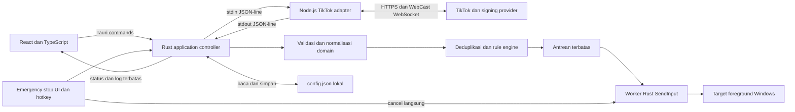

# Spesifikasi Implementasi: TikTok LIVE Gift-to-Keybind Desktop

Status: rancangan implementasi v1, belum ada aplikasi yang diimplementasikan. Bahasa normatif: **wajib** adalah persyaratan penerimaan; **opsional** tidak boleh menghambat MVP. Dokumen disusun pada 18 Oktober 2026.

## 1. Project Overview

### Tujuan dan ruang lingkup

Aplikasi desktop lokal untuk streamer yang mengubah gift TikTok LIVE menjadi penekanan tombol di aplikasi/game Windows yang dipilih. Pengguna memasukkan username streamer, menghubungkan LIVE, membuat aturan berdasarkan ID gift, memilih target, lalu mengaktifkan automation secara eksplisit.

Target awal: Windows 10/11 x64, satu pengguna lokal, satu jendela utama, satu room LIVE, satu target input, dan satu proses connector Node.js per instance aplikasi. Kelayakan kombinasi versi Windows, WebView2, Node.js, dan Tauri harus diuji sebelum rilis. ARM64, macOS, dan Linux bukan target v1.

Termasuk: koneksi/disconnect/reconnect, gift biasa dan streak, kombinasi tombol, durasi tekan, cooldown, pengulangan terbatas, antrean, konfigurasi lokal, log terbatas, start/stop, dan emergency stop.

Di luar v1: Electron, server cloud aplikasi, webhook penerima gift, akun/login TikTok, pengiriman chat, penyimpanan cookie pengguna, overlay OBS, macro script, mouse automation, driver kernel, bypass anti-cheat/UIPI, input ke background window, multi-room, dan marketplace aturan. Aplikasi membutuhkan internet untuk connector; konfigurasi, aturan, dan eksekusi keyboard tetap lokal. Mock dapat digunakan tanpa internet.

### Hasil pemeriksaan repository

| Pemeriksaan | Hasil teramati |
| --- | --- |
| Direktori kerja | `C:\Users\kille\tiktok\zynq` |
| Isi sebelum dokumen dibuat | Hanya direktori `.git`; tidak ditemukan file aplikasi melalui listing termasuk file tersembunyi di luar `.git` |
| Manifest/config | Tidak ditemukan `package.json`, lockfile aplikasi, `Cargo.toml`, konfigurasi Tauri/Vite, README, atau `issue.md` sebelumnya |
| Instruksi lokal | Tidak ditemukan `AGENTS.md` pada direktori proyek dan jalur induk yang diperiksa |
| Pemeriksaan Git | `git status` dan `git ls-files` ditolak karena ownership berbeda (`dubious ownership`), termasuk percobaan pengecualian per perintah; konfigurasi Git tidak diubah |
| Kesimpulan | Tidak ada stack/dependency/implementasi aplikasi yang dapat diaudit dari working directory. Struktur pada bagian berikut adalah usulan, bukan isi repository yang sudah ada. Riwayat/status Git tidak dapat dipastikan. |

### Status bukti

- **Fakta terverifikasi**: diperiksa dari metadata/source package versi tepat atau dokumentasi primer yang ditautkan.
- **Keputusan arsitektur**: perilaku aplikasi yang ditetapkan dokumen ini; bukan kemampuan bawaan connector.
- **Perlu verifikasi**: membutuhkan percobaan implementasi, fixture nyata, atau pengujian Windows. Jangan mengubah label ini menjadi klaim dukungan.

Halaman npm yang diminta mengembalikan HTTP 403 pada alat browsing. Verifikasi versi dilakukan melalui [metadata npm 1.2.0](https://registry.npmjs.org/tiktok-live-connector/1.2.0), [README terpublikasi 1.2.0](https://unpkg.com/tiktok-live-connector@1.2.0/README.md), dan source terpublikasi yang dibaca langsung melalui HTTP tanpa memasang atau menyimpan package. Metadata mencatat `gitHead=e4547aae50c8c5e01feaceaf3d305d3313f43946`; tag GitHub `v1.2.0` tidak berhasil diakses, sehingga tag itu tidak dijadikan bukti.

## 2. Arsitektur Sistem

### Keputusan utama

Gunakan Tauri 2 + React + TypeScript + Vite. Rust menjadi otoritas konfigurasi, status, validasi, deduplikasi, aturan, antrean, dan input. Node.js hanya menangani adapter TikTok dan proyeksi payload. Gunakan satu child process Node.js dengan stdin/stdout JSON-line. Simpan konfigurasi sebagai JSON lokal. Frontend tidak boleh menentukan keputusan eksekusi keyboard.



### Tanggung jawab dan batas komponen

| Komponen | Tanggung jawab | Batas yang wajib dipertahankan |
| --- | --- | --- |
| React | Form, validasi UX, daftar aturan, target, status, draft konfigurasi, log | Tidak mengimpor connector npm, tidak spawn proses, tidak menulis file, tidak memanggil Win32 |
| Tauri/Rust controller | Command UI, state machine, supervisor child, konfigurasi aktif, transisi stop | Satu pemilik status; callback I/O tidak mengubah state bersama secara bebas |
| Node adapter | Memuat connector, memasang listener sekali, connect/disconnect, memproyeksikan field gift, sanitasi error | Tidak membaca aturan, tidak mengirim input, tidak membuka HTTP/WebSocket server, tidak mengulang koneksi sendiri |
| Rust domain/rules | Validasi event, identitas, deduplikasi, streak finalization, matching, cooldown, prioritas, kuota | Logika murni sejauh mungkin; clock dan keyboard dapat diganti mock |
| Rust input worker | Satu batch aktif, timer pembatalan, pemeriksaan target, SendInput, ledger tombol | Hanya menerima action tervalidasi dari controller, tidak menerima raw command Node/UI |
| Rust config store | Load, validasi, migrasi, penulisan aman, backup | Path ditentukan backend, bukan arbitrary path dari frontend |

Gunakan channel terbatas menuju satu controller async, dan worker input terpisah secara logis. Jangan membuat task/thread baru untuk setiap gift atau penekanan tombol. Emergency cancellation menggunakan flag/generation dan notifikasi khusus yang dapat membangunkan worker tanpa menunggu antrean gift.

Struktur usulan saat implementasi kelak: `src/` untuk UI, `src-tauri/src/{commands,controller,connector,domain,rules,keyboard,config}` untuk Rust, `connector/` untuk adapter CommonJS Node, serta fixture di direktori pengujian masing-masing. Hindari monorepo framework/generator tambahan. Jangan membuat struktur tersebut dalam tugas dokumentasi ini.

### State machine dan kontrak UI

State koneksi: `idle`, `starting`, `connecting`, `connected`, `reconnecting`, `offline`, `stopping`, `error`. State automation terpisah: `disarmed`, `arming`, `armed`, `emergency_latched`, `faulted`.

- Startup selalu `disarmed`; tidak ada auto-start input dari file konfigurasi.
- Connect sukses tidak berarti automation aktif. `connected` hanya setelah Promise `connect()` berhasil; `websocketConnected` belum cukup.
- `start_automation` memerlukan koneksi sehat, konfigurasi valid tersimpan, target hidup, dan emergency hotkey berhasil terdaftar. Countdown 3 detik, lalu verifikasi target sedang foreground sebelum `armed`. Gift selama countdown dibuang untuk automation.
- Stop automation membatalkan batch/antrean dan melepas tombol, tetapi koneksi boleh tetap hidup untuk observasi.
- Disconnect manual juga menghentikan automation, mematikan retry, dan menutup child setelah cleanup.
- Hilang koneksi, perubahan room/target/config, child crash, kegagalan input, suspend/lock sesi, atau UI utama ditutup/dimuat ulang memaksa disarm dan mengosongkan action. Reconnect boleh otomatis, input wajib di-start lagi.
- Emergency stop terkunci sampai pengguna melakukan reset; reset menghasilkan `disarmed`, bukan langsung `armed`.

Nama berikut adalah **kontrak aplikasi usulan**, bukan API Tauri bawaan: `get_snapshot`, `connect_live`, `disconnect_live`, `save_config`, `list_targets`, `select_target`, `start_automation`, `stop_automation`, `emergency_stop`, `reset_emergency`. Command mengembalikan hasil terstruktur atau `{code, message, field?}`. Jangan mengekspos command umum seperti `execute_shell`, `send_raw_input`, atau `eval`.

UI menggunakan [Tauri commands/invoke](https://v2.tauri.app/develop/calling-rust/) untuk permintaan dan [event dari Rust](https://v2.tauri.app/develop/calling-frontend/) untuk snapshot/log. Subscribe sebelum meminta snapshot, sertakan revision monoton agar UI mengabaikan update lama, dan lepaskan listener saat unmount. Tidak perlu server HTTP untuk UI produksi.

## 3. Strategi Integrasi TikTok LIVE

### API versi 1.2.0 yang terverifikasi

| Aspek | Bukti dan implikasi |
| --- | --- |
| Runtime/export | Package ditujukan untuk Node.js; export CommonJS `WebcastPushConnection`, diinstansiasi dengan username `uniqueId` dan options. Jangan menggunakan nama class/API v2 tanpa migrasi. |
| Lifecycle | `connect()` mengembalikan Promise state; `disconnect()` bukan API async berkontrak Promise; `getState()` menyediakan antara lain `roomId`, `isConnected`, `upgradedToWebsocket`. |
| Listener | Gunakan `.on('gift', ...)`, `'connected'`, `'disconnected'`, `'streamEnd'`, `'websocketConnected'`, dan `'error'`; pasang sebelum connect. |
| Transport | HTTP dipakai untuk bootstrap/metadata/signing, lalu layanan internal WebCast dengan WebSocket jika upgrade tersedia. Library memiliki jalur request polling. Ini bukan webhook: tidak ada endpoint callback publik yang harus disediakan aplikasi. |
| Polling aktual | Source `connect()` versi ini mensyaratkan `enableRequestPolling` dan `sessionId` jika tidak mendapat upgrade. Jangan menganggap fallback anonim selalu tersedia berdasarkan README umum. |
| Gift | README memperlihatkan `giftId`, `giftType`, `repeatCount`, `repeatEnd`, `groupId`, `msgId`, `userId`, `giftName`, dan `receiverUserId`. Kehadiran di contoh bukan jaminan semua payload nyata lengkap. |
| Streak | Untuk `giftType === 1`, update memiliki repeatCount kumulatif dan final ditandai `repeatEnd === true`. Satu gift streakable pun dapat menghasilkan update dan final. |
| Konversi | Converter membuat `repeatEnd` boolean, mengubah `groupId` ke string bila ada, dan memproyeksikan gift details. Jangan menggunakan nested `monitorExtra` yang mungkin berupa angka kehilangan presisi untuk identitas. |
| Ketidaksesuaian docs | README mencontohkan argumen numerik pada `streamEnd`; source justru emit objek `{ action }`. Adapter harus menangani objek sesuai source dan menguji bentuk yang benar. |
| Error | Source emit `error` berisi `{info, exception}`. Jangan JSON-serialize exception lengkap; dapat mengandung request/cookie/response atau struktur sirkular. |

Sumber primer: [README 1.2.0](https://unpkg.com/tiktok-live-connector@1.2.0/README.md), [implementasi lifecycle/event](https://unpkg.com/tiktok-live-connector@1.2.0/dist/index.js), [converter](https://unpkg.com/tiktok-live-connector@1.2.0/dist/lib/webcastDataConverter.js), dan [error classes](https://unpkg.com/tiktok-live-connector@1.2.0/dist/lib/tiktokErrors.js). Fakta-fakta ini memverifikasi bentuk API, **belum membuktikan versi tersebut masih dapat terhubung ke LIVE pada tanggal implementasi**.

### Pilihan adapter v1

- Pin connector tepat `1.2.0`, tanpa caret/tilde; jangan diam-diam menggantinya dengan versi terbaru. Tahap awal wajib smoke test koneksi dan mencatat hasil sebelum melanjutkan integrasi live.
- Options yang dipilih: `processInitialData: false`, `fetchRoomInfoOnConnect: true`, `enableWebsocketUpgrade: true`, `enableRequestPolling: false`, `enableExtendedGiftInfo: false`. Request timeout HTTP 10 detik melalui `requestOptions.timeout`; deadline connect menyeluruh 45 detik dikelola supervisor.
- Tanpa polling dan cookie, kegagalan upgrade ditampilkan sebagai transport tidak tersedia. Jangan menambahkan login atau polling diam-diam. Ini keputusan produk untuk mengurangi resource dan cakupan credential.
- Username di-trim, boleh menghapus satu awalan `@`, panjang 1–64 karakter ASCII, whitelist huruf/angka/titik/underscore. Ini batas aplikasi; format terbaru TikTok tetap perlu diuji. Tolak URL, whitespace internal, kontrol, shell fragment, dan string kosong. V1 tidak menerima room ID manual/URL LIVE.
- Gift dipilih dengan ID numerik desimal, nama hanya label. Pengguna dapat mengambil ID dari event yang terlihat. Tidak wajib katalog/gambar gift atau API lain agar MVP berfungsi.
- Event yang tiba sebelum connect dikonfirmasi, pada attempt lama, ketika disarmed, atau saat stop tidak menghasilkan action. Tetap boleh menjadi diagnostik ringkas.

### Reconnect dan perubahan protokol

Rust adalah satu-satunya pemilik retry. Node tidak memasang timer reconnect. Setiap attempt mempunyai `connectionId` baru; setiap restart child mempunyai `processId` protokol baru. Abaikan callback/pesan attempt lama.

Untuk putus jaringan sementara atau timeout: satu retry pending dengan jeda 2, 4, 8, 16, lalu 30 detik, jitter 0–20%; maksimal 5 retry berturut-turut, kemudian tampilkan error dan tombol coba lagi. Hormati `retryAfter` yang benar-benar tersedia dan valid sebagai jeda minimum, batasi sampai 10 menit. Counter retry baru direset setelah koneksi bertahan 60 detik. Tidak ada retry loop tambahan di callback `error` dan `disconnected`.

`streamEnd`, username invalid, versi IPC tidak cocok, atau kegagalan assignment Job Object menghentikan retry. Status room offline ditampilkan dan menunggu aksi pengguna. Error signature/upgrade/extraction yang berulang mengikuti batas retry, lalu minta pemeriksaan versi/protokol; jangan menebak bahwa username pasti salah. Tidak adanya gift bukan bukti koneksi macet.

Source `disconnect()` hanya membersihkan koneksi yang sudah dianggap connected; jangan menganggapnya membatalkan Promise connect yang sedang berjalan. Pada cancel/timeout saat connecting, invalidasi attempt, minta shutdown, lalu supervisor mengakhiri child bila belum selesai dalam batas shutdown. Callback yang selesai terlambat wajib diabaikan dan koneksi ditutup. Pengujian race ini wajib.

Simpan fixture minimal yang dianonimkan dari source versi tepat dan observasi live jika tersedia. Ubah field adapter hanya setelah fixture dan kontrak diperbarui. Tidak ada jaminan replay event, urutan sempurna, atau delivery exactly-once dari TikTok. Setelah gap koneksi jangan mengarang gift yang hilang atau mengeksekusi backlog.

Perhatikan dependency jaringan tambahan: [source signing provider 1.2.0](https://unpkg.com/tiktok-live-connector@1.2.0/dist/lib/tiktokSignatureProvider.js) memuat host default `https://tiktok.eulerstream.com/` serta fallback `https://tiktok-sign.zerody.one/`. Keberadaan string tersebut terverifikasi; ketersediaan, persyaratan, data yang dikirim, dan kebutuhan layanan saat ini belum diuji. Aplikasi lokal tetap bergantung pada layanan eksternal ini. Jangan mengekspos custom signing host/header/cookie melalui UI v1.

## 4. Strategi Komunikasi Tauri dan Node.js

### Evaluasi dan rekomendasi

| Kriteria | Child process + stdin/stdout JSON-line | WebSocket loopback |
| --- | --- | --- |
| Kesederhanaan | Pipe langsung parent-child, tanpa port/discovery | Perlu bind, port discovery, handshake, dan lifecycle socket |
| Keamanan | Tidak ada listener jaringan; handle pipe dibatasi child | Perlu autentikasi, validasi Origin, batas koneksi, dan penanganan klien lokal lain |
| Resource | Menggunakan pipe proses yang sudah dibutuhkan | Menambah server/socket dan kemungkinan dependency |
| Stabilitas | EOF/exit mendeteksi proses mati; framing/backpressure harus ditangani | Putus socket harus dibedakan dari proses mati; lebih banyak state |
| Debugging | Fixture JSON-line dan subprocess mock cukup | Mudah memakai klien WS, tetapi tidak diperlukan MVP |
| Pilihan | **Wajib untuk v1** | Tidak diimplementasikan |

Pilihan didukung oleh [panduan Node sidecar Tauri](https://v2.tauri.app/learn/sidecar-nodejs/), yang juga menyebut opsi runtime Node terbundel dengan JavaScript sebagai resource. Gunakan runtime Node resmi terbundel + adapter CommonJS + dependency runtime produksi yang disalin pada proses build mendatang; tidak membutuhkan Node/npm milik pengguna. Tidak memilih SEA/`pkg` pada v1 agar dynamic require dan asset `.proto` tidak harus dipaketkan menjadi executable tunggal.

Runtime executable didaftarkan melalui `bundle.externalBin`, dengan penamaan binary sesuai target triple; adapter dan dependency dikirim sebagai `bundle.resources`. Rust me-resolve path resource dan executable terpasang secara eksplisit lalu memakai `tokio::process::Command` langsung, tanpa shell plugin. `externalBin` membantu bundling dan tidak otomatis menjalankan proses. Pola nama saat build, nama/path sesudah instalasi, serta resource path harus dibuktikan pada installer, bukan diasumsikan sama. Lihat [dokumentasi sidecar Tauri](https://v2.tauri.app/develop/sidecar/).

### Framing dan kontrak protokol aplikasi

Kontrak ini buatan aplikasi, bukan payload resmi TikTok. Format: satu objek JSON UTF-8 per baris diakhiri LF; terima CRLF dengan membuang CR terakhir. stdout khusus protokol; stderr khusus diagnostik terbatas. Pastikan log dependency tidak mencemari stdout. Jangan memakai `console.log` untuk logging adapter.

Envelope wajib: `protocolVersion: 1`, `type`, `processId`, `connectionId` (null sebelum connect), `seq` berupa integer aman yang naik per arah/per proses, `requestId` untuk command dan response, dan `payload` objek. `processId`, `connectionId`, dan `requestId` adalah string ID lokal, bukan PID OS atau ID TikTok. Rust membuat process/connection ID dan mengirimkannya pada handshake/command; Node wajib menggemakan ID yang sesuai. Field ID TikTok selalu string.

| Arah | `type` | Isi dan hasil |
| --- | --- | --- |
| Rust → Node | `hello` | Versi, processId, daftar fitur kontrak; hanya sekali |
| Node → Rust | `ready` | Reply requestId hello, versi package/runtime aktual; tidak connect otomatis |
| Rust → Node | `connect` | Username tervalidasi dan connectionId baru; options tetap milik adapter |
| Node → Rust | `ack` / `error` | Hasil command dengan requestId; connect hanya ack sukses sesudah Promise berhasil |
| Node → Rust | `connection_state` | Status attempt, roomId string/null, transport, kode alasan |
| Node → Rust | `gift` | Proyeksi field pada bagian 7; tanpa raw protobuf, URL gambar, monitorExtra, atau objek profil |
| Rust → Node | `ping` | Satu ping aktif, idle tiap 5 detik |
| Node → Rust | `pong` | RequestId ping; deadline 15 detik |
| Rust → Node | `disconnect`, `shutdown` | Stop attempt/close connector; ack setelah cleanup, shutdown keluar setelah output selesai |

Handshake deadline 5 detik. Command biasa deadline 5 detik; connect memiliki deadline 45 detik. Status error memuat kode lokal, pesan yang disanitasi maksimal 512 karakter, dan `retryable`; keputusan retry final tetap di Rust. Jangan mengirim stack/request lengkap ke UI.

Aturan parser dan kapasitas:

1. Baca chunk byte secara streaming; satu read bukan satu pesan. Maksimal 16 KiB per baris termasuk newline, kedalaman objek maksimal 16. Batasi buffer sebelum menemukan newline; jangan memakai line reader tanpa batas.
2. Validasi UTF-8, JSON object, enum type, tipe/rentang field, versi, ID attempt, seq, dan requestId. Tolak extra field di envelope/payload kontrak v1. Tidak ada eval, command shell, atau arbitrary executable path.
3. `seq` duplikat/lama diabaikan dan dicatat; gap seq menghentikan automation karena ada kemungkinan event hilang. Ini berbeda dari deduplikasi gift TikTok.
4. Baris invalid/oversize, versi salah, atau pesan tanpa handshake: hentikan kepercayaan pada child, disarm, cleanup, terminate, dan tampilkan `IPC_PROTOCOL_ERROR`. Jangan terus mengeksekusi gift setelah parser desinkron.
5. Node output queue maksimal 256 pesan dan 1 MiB total; Rust ingress maksimal 256 pesan. Tanggapi backpressure stream: `write()` false menunggu `drain`, bukan menumpuk Promise tanpa batas. Prinsip stream dirujuk pada [dokumentasi Node](https://nodejs.org/api/stream.html).
6. Jika queue ingress/output penuh, tandai overload, hentikan automation dan koneksi, lalu buang backlog secara eksplisit. Jangan drop gift diam-diam atau membuat memory queue tanpa batas. Status/emergency memakai jalur kontrol terpisah dari antrean gift.
7. Drain stdout dan stderr bersamaan agar child tidak deadlock. Batasi stderr per baris dan laju; kelebihan log diringkas, bukan disimpan terus-menerus.

### Lifecycle proses dan recovery

- Spawn hanya saat Connect, executable/path/arg tetap dari instalasi; `CREATE_NO_WINDOW`, working directory tetap, stdin/out/err piped, tidak melalui `cmd`, PowerShell, npm, atau executable dari PATH. Bersihkan variabel seperti `NODE_OPTIONS`/`NODE_PATH` dan proxy yang tidak digunakan; jangan mewariskan secret aplikasi yang tidak diperlukan.
- Rust menyimpan satu handle child dan memeriksa bahwa child sebelumnya sudah exit/reaped sebelum spawn pengganti. Klik Connect berulang bersifat idempotent ketika starting/connecting/connected.
- Gunakan Windows Job Object dengan `JOB_OBJECT_LIMIT_KILL_ON_JOB_CLOSE`; handle job tidak diwariskan child. Masukkan child ke job sebelum handshake/connect. Jika gagal, matikan child dan laporkan error. Ini melindungi dari connector yatim jika parent mati; lihat [Job Objects Microsoft](https://learn.microsoft.com/en-us/windows/win32/procthread/job-objects).
- Node menerima EOF stdin sebagai kehilangan parent: tutup connector, batalkan timer, hentikan penerimaan gift, dan keluar. Job Object tetap menjadi perlindungan ketika event loop Node macet.
- Shutdown: disarm → naikkan automation generation → cancel worker dan flush action → release tombol → kirim shutdown child → tunggu exit maksimal 3 detik → kill bila perlu → wait/reap dan tutup handle. Tidak menunggu jaringan sebelum melepas keyboard.
- Child crash/EOF/pong timeout memicu cleanup yang sama. Restart maksimal 3 kali per 5 menit untuk kegagalan proses; setelah itu error sampai pengguna mencoba kembali. Retry koneksi dan restart proses memiliki counter berbeda tetapi tidak boleh berjalan bersamaan.
- Pengganti child mulai disarmed. Deduplikasi room yang sama dipertahankan sesuai TTL, tetapi tidak pernah memulihkan action lama.

Jika kebutuhan masa depan mengharuskan WebSocket lokal: bind hanya `127.0.0.1`/`::1`, port acak, token acak sekali pakai minimal 256 bit dikirim melalui pipe, autentikasi sebelum pesan lain, validasi Origin untuk klien browser, satu klien terotorisasi, batas frame/rate/timeouts, dan tutup server bersama child. Loopback saja bukan autentikasi. Tidak ada bind `0.0.0.0` atau server publik.

## 5. Dependency Specification

Semua versi selain connector adalah **pilihan keluarga/major**, bukan klaim versi patch yang sudah diuji. Tahap 1 harus memilih rilis yang masih didukung, mencatat versi tepat Node/Rust/npm dan seluruh package/crate, lalu membuat lockfile. Build rilis memakai lockfile; jangan memakai tag `latest` sebagai kontrak. Tidak ada dependency yang dipasang dalam tugas ini.

### Frontend dan build frontend

| Dependency | Fungsi | Pengguna | Alasan pemilihan | Status | Kompatibilitas/verifikasi |
| --- | --- | --- | --- | --- | --- |
| `react`, `react-dom` | Rendering UI | Frontend | Stack yang diminta; cukup state/hooks lokal | Wajib | Versi harus berpasangan; pin setelah smoke build |
| `typescript` | Type checking | Build/UI | Mengurangi kesalahan kontrak | Wajib dev | Aktifkan strict; bukan validasi runtime |
| `vite`, `@vitejs/plugin-react` | Dev server/build static UI | Build | Integrasi React tanpa framework tambahan | Wajib dev | Periksa kebutuhan versi Node; dev server hanya loopback |
| `@types/react`, `@types/react-dom` | Tipe React | Build | Mendukung TypeScript strict | Wajib dev | Cocokkan major React |
| `@tauri-apps/api` major 2 | invoke/event | Frontend | IPC resmi | Wajib | Jangan mencampur API Tauri 1 |
| `@tauri-apps/cli` major 2 | Dev/build/bundle | Build | Tool resmi Tauri | Wajib dev | Cocokkan dengan crate/config Tauri 2 |
| `vitest` | Test UI/pure helper | Pengujian | Satu runner jika test TS diperlukan | Opsional dev | Jangan wajibkan untuk adapter Node; pilih versi kompatibel Vite |

CSS biasa dan kontrol HTML cukup. Tidak menambah router untuk satu dashboard, Redux, Socket.IO, UI framework besar, form framework, atau library animasi. Tambahkan hanya bila masalah terukur tidak dapat diselesaikan dengan primitives yang ada.

### Rust desktop/backend

| Dependency | Fungsi | Pengguna | Alasan pemilihan | Status | Kompatibilitas/verifikasi |
| --- | --- | --- | --- | --- | --- | --- |
| `tauri` major 2, `tauri-build` major 2 | Runtime dan build desktop | Rust/build | WebView sistem dan IPC | Wajib | Periksa MSRV, target Windows dan WebView2; build crate hanya build dependency |
| `serde` + derive, `serde_json` | DTO/config/IPC JSON | Rust | Satu format untuk kontrak dan storage | Wajib | Validasi batas/semantik tambahan tetap wajib |
| `tokio` | Process, pipe async, bounded channel, timer | Supervisor/controller/worker | Satu runtime bersama Tauri; cancel tanpa blocking UI | Wajib | Aktifkan hanya fitur yang dipakai, misalnya process/io-util/sync/time/rt/macros; jangan membuat runtime kedua atau fitur full tanpa alasan |
| `windows-sys` | Win32 SendInput, target, hotkey, Job Object, file replace | Rust Windows | Binding Microsoft tanpa keyboard wrapper besar | Wajib Windows | Pin versi dan feature subset hasil compile; namespace input, window messages, threading/job, filesystem, foundation sesuai API yang benar-benar dipakai |
| `tauri-plugin-single-instance` major 2 | Menolak instance kedua | Runtime | Mencegah dua rule engine mengirim input bersamaan | Wajib | Daftarkan sebagai plugin pertama, sebelum inisialisasi worker/child; instance kedua hanya mengaktifkan jendela pertama, tidak memulai child. Periksa MSRV versi terpilih. |

Gunakan error enum lokal dengan Display; crate error helper/logging tidak wajib. Gunakan koleksi standar dan clock monotonic. Tidak perlu plugin shell/HTTP/filesystem/SQL/global-shortcut bila semua kemampuan tersebut dipegang Rust. Global emergency hotkey memakai Win32 langsung; lihat bagian 6. Binding Windows dipelihara dalam [proyek Microsoft windows-rs](https://github.com/microsoft/windows-rs). Urutan registrasi single-instance mengikuti [panduan plugin resmi](https://v2.tauri.app/plugin/single-instance/); kebutuhan Rust pada dokumentasi bergerak harus dicocokkan dengan versi crate yang dikunci.

### Node connector dan runtime

| Dependency | Fungsi | Pengguna | Alasan pemilihan | Status | Kompatibilitas/verifikasi |
| --- | --- | --- | --- | --- | --- | --- |
| Runtime Node.js resmi | Menjalankan adapter/connector | Child process | Library npm membutuhkan Node | Wajib | Pilih LTS yang masih dipelihara dan mendukung OS target dari [jadwal Node](https://nodejs.org/en/about/previous-releases); pin patch, checksum, arsitektur, dan lisensi saat build |
| `tiktok-live-connector` **1.2.0 tepat** | Menerima LIVE event | Node saja | Kandidat eksplisit pengguna | Wajib bersyarat kelayakan | Metadata menyatakan `engines.node >=10.0.0`; bukan alasan memakai Node 10 atau jaminan kompatibilitas LTS terkini. API/protokol live wajib diuji |
| `axios ^0.25.0`, `websocket ^1.0.34`, `protobufjs ^6.11.2` | HTTP, WebSocket, decoding | Transitif connector 1.2.0 | Dibawa manifest package, bukan tambahan aplikasi | Transitif wajib | Rentang ini terverifikasi pada metadata; resolusi tepat belum ada. Audit advisori dan tree saat implementasi; jangan menyatakan aman tanpa audit |
| `node:process`, `node:stream`, `node:test`, `node:assert` | IPC dan test adapter | Node | Modul bawaan runtime, bukan package npm tambahan | Wajib sesuai penggunaan | Test built-in mengikuti Node yang dipilih; adapter CommonJS mengurangi toolchain |

Jangan memasang TypeScript/Babel/ts-node untuk child v1: adapter CommonJS JavaScript dengan validasi eksplisit dan JSDoc cukup. Dev dependency milik package upstream tidak ikut dibundel; asset runtime seperti `.proto` wajib disertakan. Audit native/optional dependency hasil resolusi dan fallback Windows; jangan menjanjikan semua transitif murni JavaScript tanpa inspeksi.

### Penyimpanan dan prasyarat OS

| Dependency | Fungsi | Pengguna | Alasan pemilihan | Status | Kompatibilitas/verifikasi |
| --- | --- | --- | --- | --- | --- | --- |
| `std::fs` + serde_json + Win32 file APIs | JSON, backup, replace | Config Rust | Tidak menambah database/plugin | Wajib; bukan package baru | Uji replace file existing, antivirus lock, permission denied, dan interruption |
| SQLite / crate SQLite | Query/riwayat transaksi | Tidak digunakan v1 | Belum diperlukan | Opsional masa depan | Baru dipertimbangkan jika ada kebutuhan histori besar/query, bukan karena preferensi |
| Microsoft Edge WebView2 | Rendering UI Windows | Tauri | Runtime sistem Tauri Windows | Wajib OS | Periksa [prasyarat resmi Tauri](https://v2.tauri.app/start/prerequisites/); installer menangani ketiadaan runtime, uji mesin bersih dan skenario instalasi tanpa internet |

## 6. Keyboard Automation

### Model input dan urutan eksekusi

Gunakan Windows `SendInput` melalui `windows-sys`, dibungkus satu modul Rust dengan area `unsafe` sekecil mungkin. Referensi perilaku: [SendInput](https://learn.microsoft.com/en-us/windows/win32/api/winuser/nf-winuser-sendinput) dan [KEYBDINPUT](https://learn.microsoft.com/en-us/windows/win32/api/winuser/ns-winuser-keybdinput).

1. UI menyimpan physical key code dari allowlist; backend memetakan ke tabel scan code yang diuji. V1 mendukung `KeyA`–`KeyZ`, `Digit0`–`Digit9`, `Space`, `Enter`, `Tab`, `Escape`, panah, `F1`–`F11` kecuali `F10`, serta modifier kiri `ControlLeft`, `ShiftLeft`, `AltLeft`. F12, Win, Pause, PrintScreen, keypad, AltGr/modifier kanan, Unicode text, dan arbitrary VK/scan code tidak didukung v1.
2. Satu action adalah chord: 0–3 modifier unik + tepat 1 non-modifier. Urutan down: Control, Shift, Alt, lalu tombol utama. Urutan up kebalikannya. Tidak mendukung sequence macro atau modifier saja.
3. Gunakan `INPUT_KEYBOARD`, `KEYEVENTF_SCANCODE`, `wVk=0`, `wScan` tabel; tambahkan `KEYEVENTF_EXTENDEDKEY` untuk tombol yang memerlukan prefix E0. Up menggunakan scan/extended flag yang sama plus `KEYEVENTF_KEYUP`. `cbSize` harus ukuran INPUT aktual sesuai arsitektur.
4. Sebelum down, cek cancellation generation, target foreground, kondisi tombol fisik, rate limit, dan action belum kedaluwarsa. Kirim array down, tunggu hold duration dengan timer yang dapat dibatalkan, lalu array up terbalik.
5. Setiap pemanggilan wajib memeriksa jumlah INPUT yang berhasil dimasukkan. Hasil sebagian/0 adalah fault; catat jumlah dan error OS jika tersedia, lepaskan seluruh tombol yang mungkin telah diinjeksi, disarm, dan jangan retry action tersebut. Keberhasilan API hanya berarti input dimasukkan ke stream OS, bukan target memprosesnya.
6. Simpan ledger tombol milik worker sebelum mencoba down agar partial failure tetap tercakup. Cleanup idempotent mengirim up untuk tombol dalam ledger; kosongkan sesudah hasil cleanup diproses. Jangan mengirim key-up untuk seluruh keyboard.
7. Jika key-up gagal, coba satu cleanup tambahan yang terbatas, lalu `faulted` dan tampilkan tombol mana yang mungkin belum lepas. Jangan melakukan loop SendInput tanpa batas atau mengklaim key-up pasti berhasil.

Konflik fisik: jika tombol chord atau modifier pendukung sedang ditekan pengguna saat action hendak dimulai, skip batch dengan alasan `PHYSICAL_KEY_CONFLICT`; jangan melepas tombol milik pengguna. Pemeriksaan state dan injeksi memiliki race; tidak mungkin menjamin pemisahan sempurna jika pengguna menekan tombol yang sama saat hold aktif. Jelaskan pada UI dan batasi hold, bukan memasang keyboard hook luas.

Tolak chord berbahaya/reserved termasuk Alt+F4, Alt+Tab, Alt+Escape, Ctrl+Escape, Ctrl+Shift+Escape, semua Win chord, dan kombinasi yang memakai F10. Ctrl+Alt+Delete tidak dapat dibentuk oleh allowlist karena Delete tidak didukung. Validasi identik berlaku untuk file config dan command UI; jangan hanya menonaktifkan pilihan visual.

### Target, fokus, dan privilege

V1 hanya mengirim saat target yang dipilih adalah foreground. UI menyediakan daftar jendela desktop terlihat (judul + PID); Rust menyimpan identitas runtime HWND + PID dan identitas proses yang divalidasi, bukan hanya judul. Jangan menyimpan HWND/PID ke config. Jika metadata proses tidak dapat divalidasi, target tidak dapat di-arm. Jangan menawarkan desktop/jendela aplikasi ini sebagai target.

Periksa `GetForegroundWindow` dan identitas proses tepat sebelum setiap down. Target mati/berubah/fokus berpindah: cancel, release tombol, flush queue, dan disarm; tidak mengantre untuk dilanjutkan saat fokus kembali. Saat hold aktif, cek fokus maksimal setiap 50 ms serta dengarkan event lock/suspend; timer ini hanya berjalan selama input aktif. Pergantian fokus masih bisa terjadi di antara pemeriksaan dan SendInput; ini batas teknis yang harus didokumentasikan.

SendInput tidak memiliki parameter HWND untuk mengarahkan input ke background window. Jangan mengganti implementasi dengan PostMessage atau memaksa fokus menggunakan SetForegroundWindow. Aplikasi berjalan sebagai user biasa. UIPI membatasi injeksi ke proses dengan tingkat integritas setara/lebih rendah; jangan auto-elevate. Game/anti-cheat, raw input, layout keyboard, fullscreen, atau kebijakan aplikasi dapat mengabaikan input. Pengujian per target diperlukan; tidak ada janji semua game didukung.

### Cancel, stop, dan emergency stop

- Semua wait hold/gap/rate limit dapat dibatalkan; dilarang sleep blocking selama hold. Satu worker mencegah chord saling tumpang tindih.
- Stop/disconnect/fault/emergency menaikkan generation. Worker memeriksa generation sebelum setiap down sehingga action lama tidak dapat hidup lagi akibat race. Pemeriksaan generation dan panggilan down wajib berada dalam satu critical section singkat pada gate yang juga digunakan transisi cancel; cek flag saja masih menyisakan race check-then-send. Jalur stop menandai cancel-request terlebih dahulu, mengunci gate untuk commit disarm/generation, lalu membangunkan worker. Tidak ada await, timer, disk, atau network di dalam gate; hanya pemeriksaan akhir dan panggilan SendInput. Definisikan cancel diterima sebagai transisi yang sudah committed pada gate sebelum command mengembalikan hasil. Down yang sudah masuk ke SendInput sebelum commit harus segera diikuti cleanup; sesudah commit tidak boleh ada down baru dari generation lama.
- Emergency UI dan hotkey memakai jalur cancel langsung, tidak berada di belakang antrean input, disk save, atau disconnect jaringan. Hentikan retry dan putuskan child setelah release.
- Wajib hotkey global tetap **Ctrl+Shift+F10** untuk emergency ketika fokus berada di game. Gunakan Win32 `RegisterHotKey` dengan message loop kecil dan tangani WM_HOTKEY, unregister saat exit. Ini mendeteksi shortcut, bukan menyimulasikan keyboard; [referensi RegisterHotKey](https://learn.microsoft.com/en-us/windows/win32/api/winuser/nf-winuser-registerhotkey).
- Jika hotkey gagal didaftarkan/berkonflik, tampilkan alasannya dan tolak Start; Connect dan edit config tetap boleh. Hotkey hanya memicu emergency dan tidak dapat dipakai sebagai rule.
- Target engineering untuk uji terkendali: worker memulai cleanup maksimal 100 ms setelah cancellation diterima backend. Ukur dengan fake keyboard dan Windows harness; ini kriteria desain, bukan benchmark yang sudah dicapai atau jaminan OS selalu memenuhi.
- Jalur error normal dan unwind worker wajib cleanup (explicit shutdown + guard sebagai cadangan). Force kill, abort proses, crash OS, listrik mati, atau fault saat proses Rust sudah tidak berjalan tidak dapat dijamin melepas tombol. Tidak menambah watchdog injector kedua pada v1.

## 7. Gift-to-Keybind Rules

### Model event dan identitas

`GiftObservation` adalah DTO proyeksi Node, kemudian divalidasi Rust:

| Field | Tipe/aturan |
| --- | --- |
| `connectionId`, `roomId` | String; roomId dari state connect, bukan angka monitorExtra; attempt harus aktif |
| `msgId` | String desimal nonzero, maksimal 128 karakter; wajib untuk automation gift biasa |
| `senderId` | String userId desimal, bukan nickname/uniqueId; wajib |
| `giftId` | String desimal positif, maksimal 32 karakter; normalisasi number hanya jika safe integer |
| `giftType` | Integer nonnegatif dari field giftType; tipe 1 streak, tipe lain ordinary sesuai API saat ini; field hilang/invalid ditolak |
| `repeatCount` | Safe integer positif; maksimal 1.000.000 sebagai batas parse aplikasi, bukan batas TikTok; nilai lebih besar ditolak |
| `repeatEnd` | Boolean; wajib untuk streak, nullable untuk ordinary; tidak menerima string truthy |
| `groupId` | String desimal nonzero/null, maksimal 128 karakter; wajib valid untuk automation streak v1 |
| `giftName`, `senderLabel` | Label opsional maksimal 128 karakter, kontrol dibuang; hanya display plain text |
| `receiverUserId` | String desimal/null untuk diagnostik; tidak dijadikan trigger tersendiri |

Backend menambahkan waktu diterima monotonic dan nomor urut lokal. Timestamp upstream boleh disimpan sebagai diagnostik terbatas setelah unitnya diverifikasi, tetapi tidak untuk cooldown/deadline. ID 64-bit tidak boleh dikonversi lewat JavaScript Number; string adalah otoritas. Field yang sudah berupa unsafe Number ditolak, bukan dibulatkan lalu diubah ke string.

Raw event bukan identitas transaksi yang dijamin. Pisahkan:

- Deduplikasi observasi: tuple `(roomId, senderId, giftId, groupId-or-null, msgId-or-null, giftType, repeatCount, repeatEnd)`. Tuple menjaga final tidak terbuang bila msgId sama dengan update. Jangan concat string tanpa encoding pembatas yang aman.
- Identitas streak: `(roomId, senderId, giftId, groupId)`. Finalization sekali per identitas ini; jangan hanya `(senderId, giftId)` karena streak berbeda dapat berturut-turut.
- Gift ordinary: identitas `(roomId, senderId, giftId, msgId)`; satu accepted event per identitas. Payload berbeda untuk identitas sama menjadi konflik diagnostik dan tidak menambah action.
- ID lokal/seq/connectionId tidak menggantikan ID upstream untuk deduplikasi. Cache dedup dipertahankan saat reconnect ke room yang sama, sehingga replay tidak dianggap baru hanya karena connectionId berganti. Pergantian room membuang cache/action lama setelah disarm.

Cache observasi/final ordinary/final streak masing-masing memiliki TTL 10 menit dan maksimum 10.000 entri; expiry lazy dengan maintenance paling sering sekali per detik ketika aktif. Sebelum cap penuh, hapus hanya entri yang sudah expired. Jika seluruh entri masih valid, disarm/stop koneksi dengan `DEDUPE_CAPACITY_EXCEEDED`; jangan evict identitas aktif lalu terus menjanjikan dedup. Jaminan dedup hanya dalam jendela retensi ini; restart seluruh aplikasi menghilangkan cache.

Jika identitas wajib hilang/ambigu, tampilkan `INSUFFICIENT_EVENT_IDENTITY`, tanpa input. Jangan menggabungkan gift berdasarkan waktu/nickname untuk menebak streak. Ini pilihan konservatif v1; longgarkan hanya setelah fixture membuktikan alternatif identitas aman.

### Normalisasi streak dan ordinary

| Observasi masuk | Perilaku domain |
| --- | --- |
| Ordinary, identitas baru | Emit satu `GiftFinalized` dengan count repeatCount tervalidasi |
| Streak type 1, repeatEnd false | Perbarui progress UI dan count tertinggi per streak; tidak menghasilkan action |
| Streak type 1, repeatEnd true | Finalize sekali dengan count final jika valid; boleh menerima final tanpa progress sebelumnya |
| Final count lebih kecil daripada progress tertinggi | Anggap inconsistent; tandai streak invalid/closed, tidak kirim input |
| Update count menurun/out-of-order | Abaikan progress yang lebih rendah; jangan menghasilkan delta negatif |
| Final duplikat atau update setelah final | Abaikan tanpa action |
| Streak tanpa final | Setelah 60 detik tidak ada update, tandai incomplete dan buang progress tanpa action; simpan tombstone sampai TTL untuk menolak final terlambat |
| Disconnect/Stop saat progress berlangsung | Tandai progress yang terlihat sebagai suppressed sampai TTL; tidak mensintesis final atau menjalankannya setelah Start ulang |

Progress aktif maksimal 1.000 streak; kapasitas penuh memicu disarm/stop seperti overload, tanpa flushing menjadi input. Progress diikuti juga saat disarmed untuk menandai streak yang telah dimulai sebelum Start. Streak tersebut suppressed: final yang datang setelah Start tidak mengeksekusi backlog. Final tanpa progress dapat diproses hanya ketika automation sedang armed dan identitas valid; awal streak sebelum aplikasi tersambung mungkin tidak dapat diketahui. Risiko ini harus dicatat, bukan dianggap terpecahkan oleh timestamp buatan.

Contoh deterministik: progress count 1, 2, 3 lalu final count 3 menghasilkan satu finalization count 3, bukan 1+2+3+3. Untuk streak satu unit, update count 1 + final count 1 menghasilkan satu finalization. Dua sender dengan gift sama dipisahkan. Dua groupId berbeda dari sender yang sama tetap dua streak.

### Model aturan

`Rule`: `id` string lokal stabil dan unik; `enabled`; `giftId`; `giftLabel` opsional; `priority` integer 0–100 (lebih besar lebih dahulu); `keys` chord; `holdMs`; `cooldownMs`; `repeatMode`; `fixedCount`; `maxRepeats`; `repeatGapMs`.

V1 hanya exact giftId match, tanpa regex, wildcard, nilai diamond, atau skrip. Satu aturan enabled per giftId; beberapa aturan disabled untuk gift sama boleh, tetapi Save/Enable menolak konflik enabled. Prioritas menentukan urutan batch dari gift berbeda; tidak menyelesaikan konflik konfigurasi secara diam-diam.

| repeatMode | Jumlah eksekusi chord per GiftFinalized |
| --- | --- |
| `once` (default) | 1, terlepas dari repeatCount |
| `per_unit` | `min(finalCount, maxRepeats)` |
| `fixed` | fixedCount tervalidasi, dibatasi maxRepeats |

Ketiga mode hanya berjalan setelah finalization; tidak ada mode live delta v1. `fixedCount` hanya diaktifkan pada mode fixed, tetapi tetap memiliki default valid pada data. Clamping karena cap/durasi dicatat sebagai jumlah requested/executed/skipped; jangan loop sebesar count upstream.

### Pipeline, cooldown, dan antrean

Urutan wajib: validasi attempt/payload → dedup observasi → normalisasi/finalization dan dedup semantik → pemeriksaan automation/generation → exact match aturan enabled → cek cooldown → buat satu batch → admission antrean. Finalisasi ditandai consumed sebelum cek enabled/cooldown/queue; event yang diabaikan tidak boleh hidup lagi karena replay, perubahan aturan, atau Start berikutnya.

Cooldown global per rule, bukan per sender: `now >= lastBatchStarted + cooldownMs` berdasarkan clock monotonic Rust. Periksa ketika admission dan sekali lagi saat batch mulai, karena beberapa batch mungkin menunggu. Batch yang sedang cooldown dibuang, bukan ditunda. Set lastBatchStarted tepat sebelum down pertama setelah pemeriksaan target/fisik; kegagalan SendInput tidak membuka retry event. Cooldown berlaku per batch, bukan di antara repeat internal. Pertahankan cooldown pada Stop/Start/reconnect dalam proses yang sama; ubah konfigurasi hanya ketika disarmed dan jangan menghapus cooldown aturan ber-ID sama.

Antrean maksimum 100 batch dan total maksimal 500 repeat yang direncanakan. Satu worker, tidak ada chord overlap. Urutkan pending berdasarkan priority menurun lalu urutan diterima menaik (FIFO untuk priority sama). Batch aktif tidak dipreempt oleh prioritas; emergency/cancel selalu dapat memutus. Queue penuh: tolak batch baru, jangan mengganti batch lama diam-diam. Tampilkan counter drop dan alasannya.

Batch membawa rule snapshot, config revision, automation generation, event identity, count terbatas, dan deadline. Sebelum mulai, drop jika lebih dari 5 detik sejak enqueue atau generation/revision/target berubah. Maksimum usia batch sejak mulai 10 detik; repeat tersisa dibuang ketika deadline tercapai. Sebelum setiap down, sisa waktu batch harus cukup untuk holdMs penuh; jika tidak, buang repeat tersisa. Timer hold juga dibatasi deadline batch dan selalu diikuti key-up/cleanup; jangan menunggu deadline lalu memulai hold baru. Jangan resume batch sesudah disconnect atau fokus kembali.

Antara repeat selalu key-up lengkap, gap minimal 50 ms, serta laju global maksimal 10 awal chord per detik dengan jarak minimal 100 ms. Key-up/cleanup tidak dibatasi rate limiter. Hitung penundaan secara monotonic; jika rate limit membuat batch melewati deadline, buang repeat tersisa. Semua penghitung memakai operasi aritmetika diperiksa agar tidak overflow.

## 8. Konfigurasi dan Penyimpanan

### JSON dibanding SQLite

| Aspek | JSON | SQLite |
| --- | --- | --- |
| Kebutuhan v1 | Satu konfigurasi kecil dan satu writer | Belum ada query/histori besar |
| Dependency | serde_json sudah digunakan IPC | Menambah crate/plugin dan pengelolaan DB |
| Ketahanan write | Memerlukan temp/replace/backup yang diuji | Transaksi bawaan |
| Migrasi | schemaVersion + fungsi migrasi eksplisit | Schema/migration DB |
| Keputusan | **Dipilih untuk v1** | Evaluasi ulang hanya jika kebutuhan data berubah |

Lokasi `config.json` pada direktori config aplikasi per-user yang diperoleh dari path resolver Tauri (`app_config_dir`), bukan working directory atau folder instalasi. Node tidak boleh menulis konfigurasi. Tidak ada database/log gift persisten v1.

### Struktur dan default

Contoh berikut adalah kontrak config aplikasi, bukan data repository yang sudah ada. Daftar aturan default kosong; contoh rule ini disabled dan ID gift bersifat ilustrasi, bukan klaim katalog TikTok saat ini.

```json
{
  "schemaVersion": 1,
  "revision": 1,
  "live": { "username": "" },
  "rules": [
    {
      "id": "rule-1",
      "enabled": false,
      "giftId": "5953",
      "giftLabel": "Contoh gift",
      "priority": 50,
      "keys": ["ControlLeft", "KeyK"],
      "holdMs": 100,
      "cooldownMs": 1000,
      "repeatMode": "once",
      "fixedCount": 1,
      "maxRepeats": 10,
      "repeatGapMs": 100
    }
  ],
  "ui": { "logVisible": true }
}
```

Target window, armed state, held keys, reconnect timer, cache dedup, event log, cookie, dan pending action tidak disimpan. Emergency shortcut tetap didefinisikan aplikasi. Batas keselamatan berikut konstanta backend v1, bukan field file yang bisa diperbesar pengguna:

| Parameter | Default | Batas valid/keputusan |
| --- | --- | --- |
| Jumlah aturan | 0 | Maksimal 200; ID unik, panjang ID 1–64 |
| File config | Dibuat saat save pertama | Maksimal 1 MiB sebelum parse, kedalaman 16 |
| Username | Kosong | Boleh kosong untuk menyimpan draft; Connect memerlukan validasi bagian 3 |
| holdMs | 100 | Integer 10–5.000 ms |
| cooldownMs | 1.000 | Integer 0–600.000 ms |
| repeatMode | once | Enum once/per_unit/fixed |
| fixedCount | 1 | Integer 1–50 dan tidak lebih besar dari maxRepeats |
| maxRepeats | 10 | Integer 1–50; cap akhir tetap deadline batch 10 detik |
| repeatGapMs | 100 | Integer 50–5.000 ms |
| priority | 50 | Integer 0–100 |
| giftLabel | Kosong | Maksimal 128 karakter, hanya display |
| Log runtime | 500 entri | Maksimal 512 karakter per pesan, tanpa raw payload |

Default di atas adalah batas desain yang dapat direvisi setelah pengukuran dan uji pengguna, bukan benchmark atau aturan TikTok. Frontend membantu validasi, Rust mengulangi seluruh validasi. Tolak unknown field/version, non-integer, NaN/Infinity, overflow, key duplikat, unsupported chord, gift ID invalid, duplicate rule ID, dan enabled giftId ganda. Gagal satu aturan menggagalkan save seluruh config; jangan silently skip aturan rusak.

### Versioning, save, dan file rusak

- `schemaVersion` menentukan format; `revision` meningkat hanya sesudah save sukses. Schema versi lebih tinggi: buka UI dengan error kompatibilitas dan config read-only; tidak menimpa atau downgrade otomatis.
- Schema lama hanya dimigrasikan jika fungsi migrasi versi tersebut sudah ada dan diuji dengan fixture. Backup sebelum migrasi. Jangan mengarang migrasi untuk format yang belum pernah ada.
- Hanya satu writer Rust; save berurutan. Save/config apply hanya saat disarmed; UI boleh mengedit draft saat connected. Start ditolak jika draft belum disimpan atau config invalid.
- Validasi draft lengkap → serialisasi → tulis temp file unik pada direktori yang sama → flush/sync file → replace existing dengan Win32 replace yang sesuai, atau move saat file belum ada → update revision/state aktif setelah sukses. Periksa API dan semantik Windows saat implementasi; jangan menganggap rename overwrite Unix berlaku di Windows.
- Pertahankan satu `config.json.bak` dari versi terakhir yang sudah tervalidasi. Jangan hapus config lama sebelum penggantinya siap. Gagal write/replace/permission/antivirus lock: pertahankan config aktif lama, tampilkan error, tetap disarmed. File temp dapat dibersihkan hanya setelah dipastikan milik proses aplikasi.
- Startup tanpa file: default kosong, disarmed, bukan error. File malformed/oversize/invalid: jangan menimpa; tampilkan path/alasan dan opsi pemulihan backup valid atau reset eksplisit. Sebelum reset, arsipkan file rusak dengan nama bertimestamp tanpa overwrite.
- Jika backup juga rusak, izinkan UI default dalam mode belum tersimpan; automation diblokir sampai pengguna memulihkan/reset dan save berhasil. Jangan menganggap fallback default diam-diam merupakan recovery sukses.
- Uji interruption pada tiap langkah save dan pilih last known valid file saat startup. Atomic replacement tidak menjanjikan durabilitas terhadap setiap jenis kerusakan disk/power loss.

## 9. UI/UX Requirements

Satu dashboard cukup; gunakan dialog/panel editor, tanpa banyak halaman. Label Bahasa Indonesia, keyboard accessible, status tidak hanya dibedakan dengan warna.

| Area minimum | Perilaku wajib |
| --- | --- |
| Status LIVE | Username, roomId bila ada, idle/connecting/connected/offline/retrying/error, alasan dan retry berikutnya |
| Form LIVE | Username berlabel, contoh format `@nama`, Connect dan Disconnect terpisah; cegah Connect berulang |
| Target input | Pilihan jendela dengan judul/PID, status target hidup/foreground, wajib dipilih ulang setelah startup; refresh atas aksi pengguna |
| Daftar aturan | Enable, gift ID/nama label, chord, hold, cooldown, repeat mode, priority, edit/hapus; ID gift otoritas pencocokan |
| Editor keybind | Dropdown allowlist dan rekam chord lokal saat editor fokus; preview chord, batal rekam, tolak chord berbahaya; rekam tidak mengirim SendInput |
| Pengulangan | Penjelasan once/per_unit/fixed, cap dan gap; jelaskan bahwa streak menunggu selesai |
| Start/Stop | Start Automation berbeda dari Connect; countdown, Stop selalu terlihat, indikator Armed/Disarmed/Arming/Faulted |
| Emergency | Tombol tetap terlihat dan label Ctrl+Shift+F10; hasil latched; reset perlu aksi jelas dan tidak langsung Start |
| Event log | Waktu lokal, gift ID/label, count/progress/final, rule, executed/skipped/drop dan alasan; pause tampilan tidak menghentikan automation |
| Config | Save dengan status tersimpan/error; konfirmasi hanya untuk reset file rusak/hapus perubahan draft yang nyata |

Start disabled dengan alasan spesifik, misalnya belum connected, target belum foreground, hotkey tidak tersedia, emergency belum reset, atau draft belum tersimpan. Jangan menampilkan sukses input sebagai sukses game; gunakan label “input dikirim ke Windows”.

Layout: uji 800×600 dan 1280×800, DPI 100%, 150%, 200%. Pada lebar kecil, susun panel vertikal, izinkan scroll konten/editor, dan pertahankan stop/emergency terlihat. Tabel rule boleh menjadi baris ringkas/detail panel, tanpa memotong kontrol penting. Fokus dialog kembali ke pemicu sesudah ditutup; error terhubung ke field; truncation judul panjang memiliki teks lengkap yang dapat diakses.

Jangan memuat gambar/avatar/HTML remote atau membuat username menjadi HTML. Log dikirim secara batch maksimum setiap 100 ms; status kritis dikirim segera. Maksimal 500 entri, tombol Clear hanya menghapus tampilan/log memory dan tidak mereset dedup atau cooldown. Event yang dibuang harus mempunyai counter total walau baris log diringkas.

## 10. Security and Reliability

- Trust boundary: konten TikTok, Node child, dan frontend semuanya harus divalidasi ulang ketika masuk Rust. Payload Node hanya mengandung observasi gift, tidak pernah nama executable, keybind, atau instruksi input.
- Tauri capability hanya untuk jendela utama dan kemampuan minimum. Daftarkan command aplikasi secara eksplisit, batasi pemanggil ke main window, dan verifikasi ACL/custom command pada versi yang dipilih. Jangan menganggap capability plugin otomatis mengamankan semua custom command. Referensi [Capabilities Tauri](https://v2.tauri.app/security/capabilities/).
- UI produksi memakai asset lokal; larang navigasi ke situs eksternal, remote script, eval, arbitrary file access, dan shell API. Tetapkan CSP yang diuji dengan asset build Tauri/Vite; dev-only localhost origin tidak terbawa ke rilis.
- Tidak ada HTTP/WebSocket listener aplikasi, termasuk dari connector. Outbound HTTPS/WebSocket connector tetap diperlukan. Jangan mematikan TLS verification untuk memperbaiki koneksi.
- Batas message/config/queue/count/hold/rate/cache/log wajib diberlakukan sebelum alokasi besar atau ekspansi repeat. Overflow/capacity error menghasilkan status jelas; tidak ada unbounded task/listener/timer.
- Single instance mencegah injeksi ganda. Perubahan target/config, Stop, emergency, dan fault tidak boleh berlomba meloloskan down baru: generation diperiksa worker, cleanup idempotent.
- Emergency/stop harus tetap bekerja ketika child macet, parser menerima burst, disk lambat, atau UI log penuh. Tidak melakukan network await saat memegang lock input/controller.
- Tidak menyimpan credential. Sanitasi log dari cookie/token/header, URL bertanda tangan, objek exception, dan identitas profil yang tidak diperlukan. Label dari TikTok berupa teks biasa.
- Child executable/resources berasal dari bundle, bukan file/path yang dipilih pengguna. Catat checksum runtime, lockfile, lisensi dan dependency tree pada build. Jangan download executable/dependency di startup pengguna.
- Graceful close menunggu cleanup/reap dalam batas yang ditetapkan. Tidak ada close-to-tray/autostart v1. Lock/suspend mengharuskan Start ulang setelah resume; tidak mengeksekusi timer yang terlewat sebagai backlog.
- Pengujian native keyboard hanya berjalan dalam mode opt-in pada Windows dengan target harness jelas; test unit default tidak mengirim input ke desktop developer/CI.

## 11. Performance Requirements

Tidak menetapkan angka RAM, CPU, latency gift-ke-game, atau ukuran installer sebagai hasil yang sudah dicapai. Tujuan RAM rendah dinilai dengan pengukuran release build, termasuk Rust, Node, dan seluruh proses WebView2; Tauri tidak boleh diasumsikan hanya satu proses OS.

Prinsip wajib:

1. Satu runtime desktop, satu WebView utama, maksimal satu child Node; tidak membuka browser tambahan atau dev server pada rilis.
2. Tidak menjalankan connector ketika belum Connect; setelah Disconnect child ditutup. Gunakan WebSocket upstream tanpa aggressive polling.
3. Aktivitas idle berbasis event. Timer hanya untuk heartbeat 5 detik, retry/deadline, TTL maintenance terbatas, dan fokus selama hold. Tidak polling username/status UI tiap frame.
4. Payload diproyeksikan kecil; tanpa forwarding raw roomInfo/protobuf/gambar/profil. Cache/log/queue semua memiliki cap dan expiry.
5. Jangan render setiap progress event sendiri-sendiri: batch update log/progress, pertahankan counter, dan hindari array frontend yang terus tumbuh. Emergency/status kritis tidak menunggu batch.
6. Tidak menyimpan histori gift ke disk atau menulis config pada setiap event; hanya Save eksplisit. Tidak ada loop busy-wait atau timer per unit repeat.

Protokol pengukuran saat implementasi: catat hardware, versi Windows/WebView2/Node, mode release, jumlah rule dan fixture rate. Ambil baseline idle disconnected 5 menit, connected idle 5 menit, burst mock 1.000 observasi dalam 1 detik, serta soak 30 menit dengan 10 observasi/detik. Angka ini workload pengujian, bukan klaim kemampuan layanan. Ukur working set/private bytes, CPU, jumlah child/handle, queue/drop, dan latency internal normalize→admission→input di harness.

Lulus bila batas koleksi tidak terlampaui, UI/Stop tetap responsif, child tidak mengganda, dan memori setelah warm-up tidak menunjukkan pertumbuhan terus-menerus dari queue/log/cache pada workload sama. Catat hasil aktual dan bottleneck; tetapkan anggaran RAM/latency rilis setelah baseline tersedia. Jangan melakukan micro-optimization sebelum data menunjukkan kebutuhan.

## 12. Testing Strategy

### Lapisan pengujian

- Node: `node:test` dan `node:assert` untuk adapter/proyeksi dan mock connector. Jangan menjadikan method private/deep import package sebagai kontrak produksi.
- Rust: unit/integration tests dengan fake monotonic clock, fake child transport, dan `KeyboardBackend` mock yang merekam down/up serta dapat mengembalikan partial failure. Rule engine tidak memerlukan Tauri window atau TikTok.
- Frontend: typecheck dan pengujian alur state/validasi yang penting, dengan mock invoke/event. Test runner tambahan hanya bila diperlukan.
- Windows: harness penerima keyboard di foreground untuk integration opt-in, lalu pemeriksaan manual aplikasi/game target. Bedakan event diterima harness dengan game benar-benar bereaksi.

### Matriks kasus wajib

| Area | Input/skenario | Ekspektasi |
| --- | --- | --- |
| Proyeksi gift | Fixture biasa, ID string besar, unsafe Number, null/missing/type salah | Field valid tepat; tidak kehilangan presisi; payload invalid tidak pernah menjadi action |
| Streak | Update 1→2→3→final 3, duplicate final, satu gift update+final | Satu finalization; once=1, per_unit=3, tidak menjumlahkan progress |
| Streak edge | Final saja, update menurun, final lebih rendah, groupId hilang, timeout, final terlambat | Sesuai bagian 7; ambiguous/incomplete tidak menjalankan input |
| Identitas | Sender/gift sama group berbeda; sender berbeda; msgId update=final | Streak terpisah; final tidak tertelan dedup observasi |
| Replay | Ordinary/final sama pada reconnect room sama, restart child, automation Stop/Start | Tidak bertambah action dalam TTL; pending tidak dipulihkan |
| Dedup bounds | TTL boundary, 10.000 entri valid, capacity overflow | Expiry benar; penuh memicu stop, bukan silent eviction |
| Matching | Exact giftId, label berubah, disabled, enabled ID ganda | Match tetap ID; konflik save ditolak |
| Cooldown | Dua sender pada rule sama, tepat boundary, wall clock berubah, queued batch | Global per rule, monotonic, recheck saat start; repeat internal tidak terkena cooldown lagi |
| Repeat/cap | once/per_unit/fixed, count besar/overflow, gap dan batch deadline | Count bounded; max 10 down-start/detik; selesai/up sebelum repeat berikutnya |
| Queue/prioritas | Event bersamaan, priority tie, queue penuh, event expired | Deterministik priority/FIFO, cap terjaga, drop tercatat |
| Config | Missing file, malformed, versi masa depan, chord invalid, file oversized, permission denied | Tidak overwrite data rusak/future; error jelas, tetap disarmed |
| Save interruption | Crash sebelum/sesudah temp sync/replace/backup | Last valid config atau recovery eksplisit; tidak silent reset |
| Key input | Chord Ctrl+K, panah extended, hold timer, cancellation pada tiap wait | Urutan down/up benar, up terbalik, tidak ada overlap atau down setelah cancel |
| Failure input | SendInput=0/partial, up gagal, panic unwind, physical key conflict | Cleanup terbatas, fault/disarm, ledger benar, tidak retry action |
| Foreground | Target mati, HWND reuse, fokus pindah saat hold/countdown/queue | Tidak down ke target tidak valid; cancel/release/disarm |
| Privilege/game | Target normal vs elevated, fullscreen/raw input/anti-cheat jika tersedia | Tidak ada auto-elevation atau klaim sukses palsu; hasil kompatibilitas dicatat |
| IPC framing | Chunk pecah, beberapa baris/read, CRLF, invalid UTF-8/JSON, no newline oversized | Parser bounded dan deterministik, protokol invalid menghentikan automation |
| IPC lifecycle | Wrong version/seq/attempt/requestId, Node stderr flood, backpressure, pong hilang | Tidak hang/OOM; fault/cleanup/restart dibatasi |
| Koneksi | Disconnect/error bersamaan, streamEnd objek `{action}`, connect Promise gagal/terlambat | Satu retry owner/timer; stop/offline/end membatalkan retry dengan benar |
| Shutdown | UI close, shutdown saat connect/hold/repeat, child hang, force kill parent | Cleanup normal tepat; child tidak yatim melalui Job Object; batas force kill keyboard didokumentasikan |
| Emergency | UI/hotkey ketika hold aktif, queue penuh, child macet, log flood | Cancel jalur langsung, antrean kosong, latched, tidak auto-resume |
| Single instance | Jalankan dua instance | Hanya instance pertama memiliki child/worker; instance kedua tidak mengirim input |
| UI | Window kecil, DPI tinggi, keyboard navigation, save error, reconnect | Kontrol tetap dapat diakses; state input tidak tertukar dengan koneksi |

### End-to-end Windows dan uji LIVE

Mode mock memakai protokol/adapter yang sama dengan event fixture deterministik; sumber mock dipilih hanya pada test/dev build, tidak dapat diaktifkan melalui pesan Node tak tepercaya pada rilis. Replay fixture mencakup ordinary, streak, duplicate, missing final, reconnect, malformed, dan burst.

Alur E2E wajib: mulai default disarmed → muat rule valid → Connect mock → pilih harness → Start/countdown → gift → down/up tercatat → ulangi streak/dedup/cooldown → emergency → tidak ada down berikutnya → reset tetap disarmed → close tanpa child tersisa. Rekam expected action dibanding actual.

Uji live terpisah memakai akun/room LIVE yang tersedia dan sah diakses: cek koneksi versi tepat, gift ordinary/streak, identitas group/msg, transport, serta reconnect. Jika tidak ada LIVE/gift untuk pengujian, tandai integrasi live **belum tervalidasi**, bukan menganggap mock membuktikan kompatibilitas TikTok. Jangan membuat klaim siap produksi sebelum gate tersebut terpenuhi.

## 13. Implementation Phases

Tahapan ini untuk pekerjaan implementasi berikutnya; tugas saat ini berhenti pada pembuatan dokumen. Setiap tahap wajib selesai dan diverifikasi sebelum tahap yang bergantung padanya. Jika gate live gagal, pengembangan mock boleh diteruskan tetapi rilis live tetap diblokir.

| Tahap | Pekerjaan terbatas | Hasil dan kriteria penerimaan |
| --- | --- | --- |
| 1. Audit dan fondasi | Periksa ulang repo/instruksi; pilih versi tepat; validasi Node/OS/WebView2; audit dependency 1.2.0; smoke test koneksi minimal dan packaging runtime/resource path | Matriks versi/hasil tercatat, lockfile saat implementasi, kontrak fixture awal, keputusan lanjut connector atau eskalasi versi. Tidak mengasumsikan koneksi berhasil. Gate risiko terbesar harus terlihat sebelum fitur banyak dibangun. |
| 2. Shell desktop/UI | Tauri + React/TS strict, satu dashboard, state placeholder, single-instance dan emergency hotkey | Window berjalan di Windows; default disarmed; UI minimum responsive; belum ada injeksi keyboard; hotkey conflict terlihat. |
| 3. Connector process | Supervisor, bundled Node dev path/release path, bounded JSON-line, handshake/ping/shutdown, Job Object | Mock child/connector dapat connect/disconnect; crash/hang/malformed ditangani; maksimal satu child; tidak ada server loopback atau proses yatim. |
| 4. Normalisasi event | Adapter field proyeksi, validasi ID/count, ordinary/streak, dedup/TTL/tombstone | Semua fixture bagian 12 menghasilkan finalization tepat, tidak ada keyboard. Perbedaan source/README tercakup test. |
| 5. Rule engine | Exact matching, repeat mode, cooldown, bounded priority queue, generation, fake keyboard | Expected batch/action deterministik; tidak ada real input; overflow/cancel/expiry teruji. |
| 6. Keyboard Rust | Target identity, SendInput scan code, ledger, timer cancel, foreground/physical conflict, UI/hotkey emergency | Harness opt-in menerima chord/up yang tepat; partial error/stop cleanup teruji; tidak ada down setelah cancel; batas UIPI/game didokumentasikan. |
| 7. Config/UI lengkap | JSON schema v1, backend validation, temp/replace/backup/recovery, editor rule tersambung controller | Save/load/restart benar, corrupt/future version aman, target/armed tidak dipersist, draft invalid memblokir Start. |
| 8. Integrasi dan distribusi | Gabungkan LIVE→rules→input, Windows E2E/soak, audit bundle, installer NSIS, WebView2, runtime Node dan asset produksi | Installer bekerja pada mesin bersih tanpa Node global, semua checklist wajib lulus, laporan pengukuran dan batas kompatibilitas tersedia. Live gate belum lulus berarti build hanya berstatus mock/integrasi parsial. |

Hindari menambahkan fitur opsional sebelum fase 8 memenuhi kriteria inti. Packaging awal pada fase 1 hanya proof of path/runtime; installer akhir tetap diuji ulang bersama dependency lengkap pada fase 8.

## 14. Acceptance Criteria

Checklist ini untuk menilai implementasi mendatang, bukan status pekerjaan dokumentasi.

- [ ] Tauri 2, React/TypeScript/Vite, Rust, dan satu child Node digunakan; tidak ada Electron atau server penerima webhook.
- [ ] Versi connector tepat 1.2.0 dan toolchain/runtime/resolusi dependency terkunci; perubahan versi disertai keputusan eksplisit dan revalidasi adapter.
- [ ] Fresh install Windows 10/11 x64 yang diuji dapat membuka UI tanpa Node global; WebView2 dan bundled Node/resources ditangani installer.
- [ ] Connect menggunakan username valid dan melaporkan state aktual; upgrade WebSocket gagal tidak diam-diam menjadi polling/cookie flow.
- [ ] API versi tepat dan payload gift nyata telah diverifikasi, termasuk ordinary/streak/groupId/msgId; jika belum, status integrasi live ditandai belum lulus.
- [ ] Start hanya dapat dilakukan secara eksplisit setelah target, koneksi, config tersimpan, dan hotkey valid; startup/reconnect/resume selalu disarmed.
- [ ] Streak 1→2→3→final 3 menghasilkan once=1 atau per_unit=3; duplikat final menghasilkan 0 action tambahan dalam TTL.
- [ ] Ordinary duplicate, replay lintas reconnect room sama, sender berbeda, dan streak berbeda mengikuti aturan identitas yang diuji.
- [ ] Cooldown global per rule dan semua mode repeat sesuai definisi, memakai monotonic clock dan cap/deadline backend.
- [ ] Prioritas/FIFO deterministik, satu batch input aktif; antrean maksimal 100 batch/500 planned repeat, expiry/drop terlihat.
- [ ] IPC maksimal 16 KiB/baris, buffer/queue/log/cache bounded; malformed/oversized/wrong-attempt tidak menghasilkan input.
- [ ] Kombinasi tombol menghasilkan down/up berurutan dan lengkap pada harness; hasil SendInput diperiksa; partial failure melakukan cleanup dan disarm.
- [ ] Target tidak foreground/mati, physical key conflict, atau rule invalid tidak menghasilkan down baru; tidak ada background injection atau auto-elevation.
- [ ] Stop/emergency/fault/shutdown membatalkan wait dan melepas ledger; tidak ada down dari generation lama setelah cancel diterima.
- [ ] Emergency UI dan Ctrl+Shift+F10 bekerja saat game fokus, child hang, dan antrean penuh; reset tidak mengaktifkan automation.
- [ ] Pada pengujian terkendali, cleanup mulai maksimal 100 ms setelah cancellation diterima backend; hasil aktual dicatat, keterbatasan force kill dijelaskan.
- [ ] Putus/reconnect/crash hanya mempunyai satu retry owner; batas retry/restart dipatuhi; Stop/streamEnd tidak memicu reconnect liar.
- [ ] Child dihentikan/reaped pada Disconnect/exit; Job Object mencegah child yatim saat parent dipaksa mati; tidak ada child ganda setelah reconnect berulang.
- [ ] Config valid tersimpan/readback; file rusak/future/permission denied tidak ditimpa diam-diam; backup/reset eksplisit dan interruption test lulus.
- [ ] Armed/target handle/queue/cookie/log tidak tersimpan; perubahan config hanya diterapkan saat disarmed.
- [ ] UI lulus ukuran/DPI yang ditetapkan, keyboard navigation, status jelas dan stop/emergency selalu dapat diakses.
- [ ] Bounded burst/soak selesai tanpa koleksi tak terbatas, stuck worker, proses ganda, atau pertumbuhan memori terus-menerus; pengukuran release dilaporkan.
- [ ] Unit/mock E2E berjalan tanpa LIVE dan tanpa injeksi desktop default; native input test opt-in pada harness.
- [ ] Audit dependency/bundle tidak menyisakan risiko kritis/tinggi yang belum ditangani atau diputuskan secara eksplisit; keterbatasan game/protokol tercatat sebelum rilis.

## 15. Risks, Assumptions, and Open Questions

### Risiko dan keputusan yang perlu diverifikasi

| Hal | Status saat ini | Dampak dan cara menutup ketidakpastian |
| --- | --- | --- |
| Connector 1.2.0 masih dapat dipakai LIVE | API/source terverifikasi; koneksi live belum diuji | Gate fase 1: smoke test, signing, WebSocket, dan gift nyata. Jika gagal, laporkan hasil serta kandidat migrasi; jangan mengganti versi diam-diam. |
| Protokol/API internal TikTok | Connector menyatakan proyek tidak resmi | TikTok dapat mengubah handshake, schema, endpoint atau pembatasan. Isolasi adapter dan gunakan fixture; tidak menjanjikan SLA/event lengkap. |
| Signing provider eksternal | Host ada pada source 1.2.0; availability/kebutuhan terkini belum dibuktikan | Periksa request/data/terms/biaya yang benar-benar berlaku saat implementasi. Jika membutuhkan credential/layanan di luar scope, nyatakan blocker dan minta keputusan spesifik. |
| Dependency transitif versi lama | Rentang axios/websocket/protobufjs terverifikasi, resolusi/advisori belum diaudit | Audit hasil lockfile dan native optional modules di Windows. Patch/override hanya sesudah compatibility test dan keputusan terdokumentasi; pin direct package saja tidak cukup. |
| Identitas gift/streak | Field ada dalam contoh dan converter, jaminan uniqueness/kelengkapan upstream belum diketahui | Kumpulkan fixture ordinary/multiple sender/multiple streak/reconnect. V1 skip jika msgId ordinary atau groupId streak tidak valid; ini dapat mengurangi gift yang diproses. |
| Delivery dan replay | Tidak ada bukti jaminan exactly-once atau recovery gap | Dedup dibatasi TTL dan proses berjalan; tidak menyatakan event lengkap sesudah koneksi terputus. Jangan persist/replay input. |
| Streak mulai sebelum sambungan/Start | Progress yang terlihat dapat suppressed; awal yang tidak terlihat tidak dapat dipastikan | Uji `processInitialData:false` dan late final. Final tanpa progress saat armed diterima sesuai aturan, dengan risiko batas observasi yang dijelaskan. |
| Node packaging | Dipilih runtime resmi + CommonJS/resources; belum ada proof installer | Fase 1/8 buktikan path setelah instalasi, asset `.proto`, dependency production, checksum/lisensi, Unicode/spasi path, dan mesin tanpa Node global. SEA/pkg bukan fallback otomatis. |
| Target OS/runtime | Windows 10/11 x64 dipilih; build/version matrix belum ada | Pilih Node LTS dan WebView2 yang mendukung versi Windows target dari sumber resmi, uji mesin bersih. Dukungan runtime tidak sama dengan status support OS vendor. |
| Game target belum disebutkan | Belum ada aplikasi/game referensi pengguna | Harness membuktikan urutan input saja. Sebelum klaim kompatibilitas, catat nama/versi game, fullscreen mode, integrity level, layout, dan hasil manual; tidak perlu menebak game saat membuat MVP. |
| UIPI/anti-cheat/background | Keterbatasan Win32 dan kebijakan target | Target foreground pada privilege yang sesuai; tidak menambah bypass/driver atau menjanjikan universal support. |
| Force kill dan tombol tertahan | Cleanup normal dirancang, proses mati paksa tidak dapat dijamin | Hold bounded, ledger/cleanup/emergency, jelaskan batas. Watchdog kedua memerlukan rancangan/izin scope baru dan tidak termasuk v1. |
| Angka limit/rate/UI minimum | Keputusan awal dokumen, bukan hasil benchmark | Ukur fase 8; perubahan harus memperbarui konstanta, test, UI, dan acceptance criteria bersama-sama. |
| Riwayat repository | Working tree tampak kosong, Git ownership menghambat audit | Periksa kembali Git melalui environment berizin sebelum setup implementasi; jangan mengasumsikan tidak ada commit/branch. Tidak perlu mengubah config Git untuk tugas dokumen. |

### Asumsi produk v1 yang telah dipilih

- Satu room dan satu target foreground cukup; mapping berdasarkan giftId, satu aturan enabled per giftId.
- Pengulangan streak berjalan setelah final, bukan per progress. Cooldown global per rule; queue overload/drop mengutamakan batas dan keterlihatan dibanding menjalankan semua gift.
- User memilih target setiap sesi dan menekan Start lagi setelah putus/fokus berubah. Tidak ada auto-arm, auto-elevation, credentials, atau persist queue.
- JSON memenuhi kebutuhan konfigurasi; event log hanya memory. Node tetap diperlukan untuk menjalankan package npm dan tidak dijalankan di WebView.

Keputusan ini memberi jalur implementasi default tanpa menunggu pilihan tambahan. Hal yang benar-benar belum pasti adalah kelayakan LIVE 1.2.0/signing, kelengkapan identitas event, versi runtime yang lolos matriks Windows, hasil packaging, dan kompatibilitas game nyata. Jika gate gagal, catat bukti dan opsi perubahan beserta dampaknya sebelum memperluas scope.

### Referensi primer untuk implementasi

Referensi di bawah dibaca atau digunakan untuk pemeriksaan pada tanggal dokumen; gunakan URL versi tepat untuk connector dan verifikasi ulang dokumentasi yang bergerak ketika versi implementasi dipilih.

- [Package yang diminta pengguna di npm](https://www.npmjs.com/package/tiktok-live-connector/v/1.2.0) — halaman tidak dapat dibaca (403); bukan bukti isi API.
- [Metadata registry npm 1.2.0](https://registry.npmjs.org/tiktok-live-connector/1.2.0), [README 1.2.0](https://unpkg.com/tiktok-live-connector@1.2.0/README.md), [dist/index.js 1.2.0](https://unpkg.com/tiktok-live-connector@1.2.0/dist/index.js).
- [Gift converter 1.2.0](https://unpkg.com/tiktok-live-connector@1.2.0/dist/lib/webcastDataConverter.js), [signing provider 1.2.0](https://unpkg.com/tiktok-live-connector@1.2.0/dist/lib/tiktokSignatureProvider.js), [error definitions 1.2.0](https://unpkg.com/tiktok-live-connector@1.2.0/dist/lib/tiktokErrors.js).
- [Tauri: sidecar binary](https://v2.tauri.app/develop/sidecar/), [Node sidecar](https://v2.tauri.app/learn/sidecar-nodejs/), [prerequisites](https://v2.tauri.app/start/prerequisites/), [capabilities](https://v2.tauri.app/security/capabilities/), [single instance](https://v2.tauri.app/plugin/single-instance/), [bundle resources](https://v2.tauri.app/reference/config/#resources), [PathResolver](https://docs.rs/tauri/latest/tauri/path/struct.PathResolver.html).
- [Tauri: frontend → Rust](https://v2.tauri.app/develop/calling-rust/), [Rust → frontend](https://v2.tauri.app/develop/calling-frontend/).
- [Microsoft: SendInput](https://learn.microsoft.com/en-us/windows/win32/api/winuser/nf-winuser-sendinput), [KEYBDINPUT](https://learn.microsoft.com/en-us/windows/win32/api/winuser/ns-winuser-keybdinput), [RegisterHotKey](https://learn.microsoft.com/en-us/windows/win32/api/winuser/nf-winuser-registerhotkey), [Job Objects](https://learn.microsoft.com/en-us/windows/win32/procthread/job-objects), [Rust bindings](https://github.com/microsoft/windows-rs).
- [Node: stream/backpressure](https://nodejs.org/api/stream.html), [process I/O](https://nodejs.org/download/release/v22.17.0/docs/api/process.html), [release schedule](https://nodejs.org/en/about/previous-releases).
